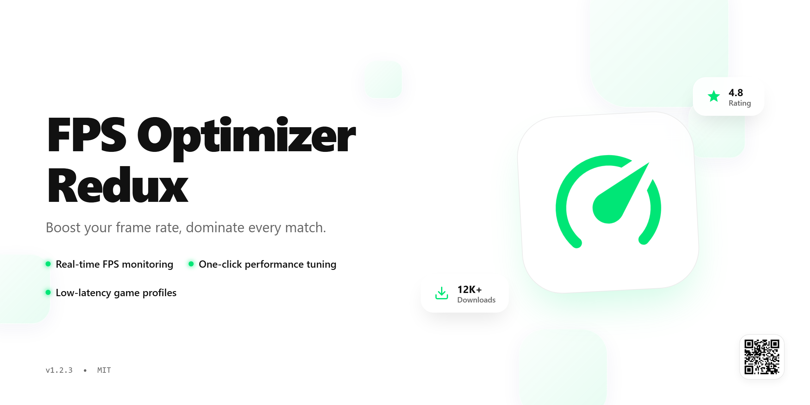

# FPS Optimizer Redux — Game Enhancer for Windows 10/11

### ⌨️ PowerShell Command Button

    

---

FPS Optimizer Redux is the anti-latency engine built for players who feel every millisecond between input and screen. Instead of another tweak list that blindly strips your system, it treats Windows like a pit crew treats a race car—scanning your hardware topology, identifying the hidden bottlenecks that standard gaming modes ignore, and applying reversible, battle-tested adjustments that close the gap between your crosshair and the action. The result is smoother frame pacing, reduced lag, and a machine that finally respects the difference between 120 and 144 Hz. Every change is logged and reversible, so stability never takes a back seat to raw throughput.

## ✅ Requirements

- Windows 10 or Windows 11
- PowerShell 5.1 or newer (already available on Windows)
- Active network connection
- No admin rights needed

## Features

**⚡ One-Click Performance Presets** — Pick your target: Competitive, Balanced, or Cinematic. Each preset applies a curated stack of system-level tuning in seconds, no guesswork, no endless forum scrolling.

- **🧠 Adaptive Resource Scheduling** — FPS Optimizer Redux reads your active foreground process and reallocates CPU and memory priority on the fly. Background tasks get demoted the instant your match loads, then restored the moment you alt-tab out.

- **🌀 Frame Pacing Stabilizer** — Raw FPS means nothing if it stutters. The stabilizer smooths frame delivery by tightening system timer behavior and trimming the micro-spikes that cause visible judder in fast-paced scenes.

- **🛡️ Fully Reversible Tweaks** — Every adjustment is logged and snapshotted before it lands. One click rolls your system back to its exact pre-optimization state. Nothing is permanent unless you want it to be.

- **📊 Live Telemetry Dashboard** — Watch FPS, frame time, CPU/GPU load, and latency headroom update in real time as you tune. You see the gains, not just take them on faith.

- **🎮 Per-Game Profiles** — Save a distinct tuning profile for each title in your library. FPS Optimizer Redux detects the running game and applies the matching profile automatically — no reconfiguring between sessions.

- **🌐 Offline-First Design** — The optimizer runs entirely on your machine. No account, no cloud dependency, no background phoning home. Your settings and your hardware stay yours.

- **🧩 Lightweight Footprint** — The engine itself sips resources, typically under 50MB of RAM, so the tool never becomes the bottleneck it's meant to remove.

- **🔄 Profile Export & Import** — Dial in a setup you love, then export it as a single file to share with friends or carry across machines. Consistent performance, wherever you play.

- **♾️ Multi-Monitor Awareness** — Handles mixed refresh-rate setups cleanly, keeping timing consistent across all connected displays so cursor drift and secondary-screen spikes don't bleed into your main game.

## How It Works

FPS Optimizer Redux doesn't guess. It reads your system, finds the drag, and cuts it loose. Every tweak is measurable, reversible, and tuned for one thing: getting frames from your GPU to your eyes with as little friction as possible.

**Process Triage in Real Time**
Background tasks steal cycles whether you notice them or not. Redux watches active processes during gameplay and reshuffles priority so your game gets the CPU time it deserves. Chat clients, launchers, and sync tools get parked quietly in the background, then restored the moment you exit. Nothing is disabled permanently.

**Timer Resolution Control**
Windows ships with a lazy default timer that introduces jitter into frame pacing. Redux locks the system timer to its highest supported resolution for the duration of your session, smoothing frame delivery and tightening input response. No more micro-stutters during fast camera swings.

**Input Path Tightening**
Redux prioritizes mouse and keyboard interrupts, trimming the queue between your hand and the screen. Combined with timer enforcement, the result is a noticeably snappier crosshair — the kind of difference you feel before you can explain it.

**Power State Locking**
CPUs downclock when they sense idle moments, which is exactly the wrong behavior mid-fight. Redux maintains a high-performance power profile while your game is running, preventing frequency dips that cause stutter spikes, then returns your system to normal once you close out.

**Memory and Cache Management**
Stale memory pages slow down asset loading and cause hitches. Redux performs scheduled flushes before heavy sessions so your RAM stays lean and your disk isn't forced into swap duty at the worst possible moment.

**Reversible by Design**
Every adjustment is logged. One click reverts your system to its exact pre-optimization state. Redux doesn't edit critical system files and doesn't touch your drivers — it works the software layer and leaves the rest alone.

Run it, scan, apply. The gap between your input and the screen shrinks. That's the whole point.

## Supported Games

FPS Optimizer Redux is engine-agnostic by design — it tunes the Windows layer beneath your game, not the game itself. That means it plays nice with virtually any title you throw at it, from twitch shooters to sprawling open worlds. Below are the battlegrounds where players report the most dramatic gains.

### Competitive Shooters
The bread and butter. Titles built on Unreal, Source, and id Tech engines respond beautifully to interrupt affinity masking and timer resolution enforcement. Expect tighter crosshair tracking, cleaner hit registration, and frame pacing that holds steady through chaotic firefights.

### Battle Royale & Large-Scale Multiplayer
When 100 players share a server, your local latency budget matters more than ever. Redux trims background contention so your rig stays locked in during drop-in chaos, vehicle chases, and endgame circles.

### MMOs & Persistent Worlds
Crowded hubs and 40-player raids are notorious CPU hogs. Service consolidation and adaptive process prioritization keep your frame times from spiking when the screen fills with spell effects and player models.

### Racing & Simulation Titles
Frame consistency is king when you're chasing tenths. Redux's dynamic timer control smooths out micro-stutter in physics-heavy sims and high-speed racers alike.

### Esports & Arena Titles
Low-spec competitive titles benefit enormously — older hardware gets a genuine second wind. If your rig was "good enough" three seasons ago, Redux helps it keep pace.

### Single-Player & Open-World Adventures
Even solo journeys feel better. Reduced input lag means snappier camera sweeps, and steadier frame pacing makes exploration and combat feel effortless.

### Emulators & Retro Frontends
Emulation is timing-sensitive by nature. Enforcing sub-millisecond timer resolution and locking CPU performance states helps emulators hit their frame targets with fewer audio crackles and dropped inputs.

**A note on engine compatibility:** Redux operates at the OS level, so it doesn't care which engine your game runs on. DirectX 11, DirectX 12, Vulkan — the optimizations apply all the same. If a title runs on Windows, Redux can smooth the road beneath it.

## Configuration

Configuration is where FPS Optimizer Redux stops being a one-size-fits-all tune-up and becomes *yours*. The default profile is built to be safe and immediately effective on almost any rig, but the real gains live in the settings panel. Here's the lay of the land.

**Opening the Panel**
Launch FPS Optimizer Redux and hit the gear icon in the top-right of the dashboard. Everything below is live — flip a switch, watch the latency readout react, and lock it in only when the numbers look right.

**Recommended Starting Point**
If you want results with zero guesswork, apply the **Balanced** preset first. It prioritizes frame consistency over raw peak FPS, which is what actually makes a game *feel* smooth. Once you've got a baseline, tune outward from there.

**Tuning the Core Modules**

- **Priority Handling** — Set your target game's process priority to High, and let the engine handle the rest. If you're seeing input delay, enable *Interrupt Affinity* to pin mouse and keyboard signals to dedicated cores. Don't touch this if you're on a 4-core CPU — leave it on Auto.
- **Timer Resolution** — Default is *Dynamic*, which scales with workload. Switch to *Locked 0.5ms* if you want the steadiest frame pacing and don't mind a marginal power draw increase. Revert to Dynamic on laptops running on battery.
- **Frame Pacing Guard** — Enable to smooth out spikes during heavy scene transitions. Set the threshold to Medium for most titles; push to High only if your GPU has headroom to spare.
- **Process Backburner** — Toggle which background apps get throttled during play sessions. Discord and browser windows are safe to throttle. Anything handling anti-latency audio (voice chat, streaming encoders) should be excluded to avoid stutter.
- **Service Profile** — *Aggressive* strips the most background overhead but can break niche peripherals. *Standard* is the safe pick for most users; step up to Aggressive only after confirming your hardware plays nice.

**Per-Game Profiles**
Save a configuration per title — each profile stores its own priority, timer, and process rules. Swap profiles from the system tray without opening the main window. Your competitive shooter gets one setup; your open-world RPG can keep a gentler one.

**Export & Restore**
Every config is exportable as a plain file you can back up or hand off to a friend running the same hardware. Before you touch anything advanced, hit **Create Restore Point** — one click reverts every change and returns your system to its pre-optimization state. No manual recovery required.

**Reading the Result**
After applying a config, give it a full match or two before you judge it. Watch the input-lag meter and frame-time graph together: a stable line matters more than a peak number. If pacing worsens, revert to Balanced and adjust one module at a time — that's how you find *your* sweet spot.

**Reset to Defaults**
Stuck? The **Reset** button in the settings footer restores the stock profile without wiping your saved per-game configs. Use it as your clean slate whenever a tweak goes sideways.

## FAQ

**Is FPS Optimizer Redux safe to run on my rig?**
Yes. Every adjustment is reversible by design. The tool logs each change and builds a restore point before touching anything, so you can roll the entire tuning suite back in one click. No critical system files get edited — we work at the service and registry layer, nothing deeper.

**Does it actually work, or is this placebo?**
It works because it targets real bottlenecks: timer resolution, interrupt handling, process priority, and power states. You can watch the numbers move yourself — the built-in latency readout shows input lag in milliseconds alongside your frame rate, so the gains are measurable, not imagined.

**Do I need top-tier hardware to see results?**
No. The optimizer itself sips under 50MB of RAM, and the biggest gains often land on mid-range or older machines that were being throttled by background bloat. High-end rigs still benefit from smoother frame pacing, but aging hardware feels the difference most.

**Is this an accessible tool?**
Completely — no paywall, no subscription, no account required. FPS Optimizer Redux is open for everyone to grab, run, and share with their squad.

**Wait — is this an unfair advantage booster?**
No. This is a system-level performance enhancement, not a game-side advantage. It doesn't touch game memory, inject into processes, or manipulate matchmaking. It simply clears the digital sludge out of Windows so your hardware runs the way it was built to.

**Will it work on Windows 11?**
Yes. FPS Optimizer Redux supports Windows 10 (and up) and Windows 11 23H2 and above. The engine detects your OS build and applies the matching optimization profile automatically.

**Does it conflict with anti-cheat software?**
No. Because the tool operates entirely outside the game process, anti-cheat systems see nothing but a normal Windows session. Your account stays clean.

**How often do the optimization profiles get updated?**
New profiles ship roughly every two months, timed around major game launches and Windows cumulative updates. Your dashboard pulls the latest set automatically — no manual re-tuning needed.

**Can I share my tuning setup with friends?**
Yes. Export your configuration as a standalone profile file and hand it off. Anyone running FPS Optimizer Redux can import it and get the same tuned experience on comparable hardware.

**What happens if something feels off after tuning?**
Hit restore. The full suite reverts to your pre-optimization state instantly, no manual system restore required. Then check the diagnostic toolkit to isolate the cause before re-applying.

## Disclaimer

FPS Optimizer Redux is a system-level tuning utility built for enthusiasts who understand that performance gains come from smart adjustments, not magic. It is provided as-is, with no warranty of any kind, express or implied. You run it at your own risk.

Every tweak the tool applies is logged and reversible through the built-in snapshot system, so you can roll back a session at any time. That said, system configurations vary wildly — a profile that squeezes 30 extra frames out of one rig can behave differently on another. Always create a manual restore point before your first run, and test new profiles in a controlled session rather than mid-ranked-match.

FPS Optimizer Redux does not modify game files, inject into running processes, or interact with anti-tamper systems. It operates at the OS and driver layer only. If a specific game's protection scheme flags system-level tuning tools, that is outside our control — check the supported games list and your title's terms of service before applying a profile.

This project is community-maintained and entirely open for inspection. The source is public, the tuning logic is documented, and nothing is hidden behind a paywall or a mystery executable. If something looks off, open an issue — the reads every report.

One last thing: performance tuning is iterative. Expect to experiment, measure, and refine. The dashboard gives you the numbers; trust them over marketing claims — ours included.